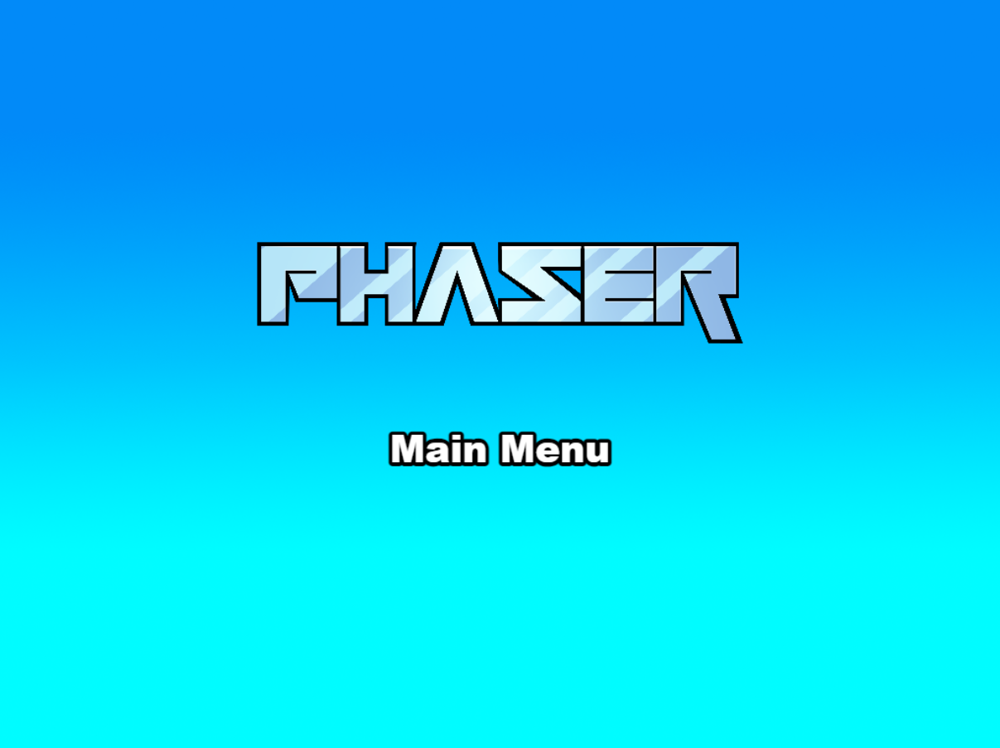

# SoccerPasión

Fútbol arcade 11 contra 11: Atlético Pasión (usuario, azul) contra Deportivo Brasa (IA, coral). Phaser 4, TypeScript y Vite, sobre la plantilla existente.

## Ejecutar en Windows

Abre una terminal en `D:\Proyectos\GameDev\Phaser\SoccerPasion`:

```powershell
npm.cmd run dev-nolog
```

Abre la dirección que indique Vite (por defecto `http://localhost:8080/`). `dev-nolog` ejecuta el mismo juego sin el script de registro de la plantilla. También sigue disponible `npm.cmd run dev`.

Menú inicial con una única opción: **START**. Pulsa **Intro** o **Espacio** para empezar. Los partidos duran 4 minutos efectivos; el reloj representa 90 minutos y se detiene durante las interrupciones. La duración se ajusta en `src/game/config/tuning.ts`.

## Controles

| Tecla | Acción |
| --- | --- |
| ↑ ↓ ← → | Movimiento en ocho direcciones; orientación durante un saque |
| Espacio, toque corto | Pase hacia un compañero en la dirección aproximada |
| Espacio, mantener y soltar | Tiro; más duración significa más potencia, hasta 0,72 s |
| Espacio, sin balón | Entrada deslizante; cerca de balón aéreo, cabezazo |
| X | Alternativa a espacio para todas las acciones; útil si el teclado no registra dos flechas y espacio a la vez |
| ← / → justo tras golpear | Efecto lateral durante 0,30 s |
| Dirección contraria al ataque tras golpear | Elevar el balón |
| Dirección del ataque tras golpear | Reducir elevación |
| Q | Cambiar manualmente de futbolista; la selección también es automática |
| P | Pausar o continuar |
| F | Pantalla completa o ventana |
| Esc durante pausa | Volver al menú |
| Intro o R en resultado | Revancha |
| Esc en resultado | Menú |

Primera parte: atacas arriba (↑ mantiene raso y ↓ eleva tras tirar). Segunda: atacas abajo (↓ mantiene raso y ↑ eleva). El jugador controlado tiene triángulo azul y número. El balón no está pegado: conduce con contactos sucesivos y anticipa los cambios de dirección.

Para pasar o disparar en diagonal, combina dos flechas (por ejemplo ↑ + →) al golpear o soltar espacio. El pase asistido busca un compañero en ese sector; si no lo hay, sale en la dirección elegida. Mantener esas flechas después del golpeo conserva la trayectoria: cambia de dirección durante la ventana de efecto para aplicar aftertouch.

Si puedes correr en diagonal pero no se ejecuta el golpeo, compara **dos flechas + X** con **dos flechas + espacio**. La etiqueta «ESPACIO / X» se ilumina al recibir una acción mantenida. Si solo funciona X, apunta a bloqueo de esa combinación en el teclado; aún debe confirmarse con tu prueba. El software no puede recuperar una pulsación que el dispositivo no envía.

En defensa conservas tu futbolista salvo que un compañero esté a 70 píxeles del balón, tú estés a más de 140 y ese compañero tenga una ventaja de distancia de al menos 90. El cambio se decide por proximidad real, sin anticipar la trayectoria. Tras cambiar, se mantiene la selección un segundo para evitar saltos continuos. Q permite cambiar sin esa restricción. En ataque se conserva la selección automática y la del receptor del pase.

Un saque se ejecuta con espacio; el sistema lo realiza automáticamente si no se pulsa para evitar bloqueos. Los porteros son automáticos. Pérdida de foco pausa el partido; P continúa al regresar.

En cuanto un futbolista de campo de tu equipo recibe o recupera el balón, pasa a tu control, aunque estuviera activo un bloqueo temporal de selección. La IA no conduce, pasa ni dispara por ese poseedor. Los porteros siguen siendo automáticos.

Todos los futbolistas tienen la misma habilidad de control: **0,95 en una escala propia de 0 a 1**, configurable en `TUNING.player.ballControl`. Mejora recepción, conducción, cambios de dirección y frenada mediante contactos; el balón sigue físicamente libre.

## Comprobaciones

```powershell
npm.cmd run typecheck
npm.cmd test
npm.cmd run build-nolog
```

La compilación queda en `dist/`. Para ajustar velocidad, física, IA o duración, modifica `src/game/config/tuning.ts`.

## Documentación y alcance

La configuracion para publicar automaticamente con GitHub Pages esta en `.github/workflows/deploy.yml`. Consulta [publicacion y actualizaciones](docs/PUBLISHING.md). El destino previsto es `https://darecagames.com/soccerpasion/`; su disponibilidad depende de completar el primer despliegue.

- [Investigación de SWOS y selección de recursos](docs/RESEARCH.md).
- [Créditos, URLs y licencias de recursos](docs/ASSETS.md).
- [Arquitectura, pruebas y límites conocidos](docs/IMPLEMENTATION.md).

Hay partido completo, saques, goles, descanso, cambio de campo y resultado. Quedan fuera de juego, faltas, tarjetas y penaltis. Las carreras usan sprites CC0 en ocho direcciones; las acciones especiales reutilizan sus poses y transformaciones. La IA necesita valoración humana de dificultad. No se afirma equivalencia exacta con SWOS ni 60 FPS medidos. El usuario realiza la prueba jugable; no se controla su PC ni su navegador.

---

## Documentación original de la plantilla

This is a Phaser project template that uses Vite for bundling. It supports hot-reloading for quick development workflow, includes TypeScript support and scripts to generate production-ready builds.

**[This Template is also available as a JavaScript version.](https://github.com/phaserjs/template-vite)**

### Versions

This template has been updated for:

- [Phaser 4](https://github.com/phaserjs/phaser)
- [Vite 6.3.1](https://github.com/vitejs/vite)
- [TypeScript 5.7.2](https://github.com/microsoft/TypeScript)



## Requirements

[Node.js](https://nodejs.org) is required to install dependencies and run scripts via `npm`.

## Available Commands

| Command | Description |
|---------|-------------|
| `npm install` | Install project dependencies |
| `npm run dev` | Launch a development web server |
| `npm run build` | Create a production build in the `dist` folder |
| `npm run dev-nolog` | Launch a development web server without sending anonymous data (see "About log.js" below) |
| `npm run build-nolog` | Create a production build in the `dist` folder without sending anonymous data (see "About log.js" below) |

## Writing Code

After cloning the repo, run `npm install` from your project directory. Then, you can start the local development server by running `npm run dev`.

The local development server runs on `http://localhost:8080` by default. Please see the Vite documentation if you wish to change this, or add SSL support.

Once the server is running you can edit any of the files in the `src` folder. Vite will automatically recompile your code and then reload the browser.

## Template Project Structure

We have provided a default project structure to get you started. This is as follows:

## Template Project Structure

We have provided a default project structure to get you started:

| Path                         | Description                                                |
|------------------------------|------------------------------------------------------------|
| `index.html`                 | A basic HTML page to contain the game.                     |
| `public/assets`              | Game sprites, audio, etc. Served directly at runtime.      |
| `public/style.css`           | Global layout styles.                                      |
| `src/main.ts`                | Application bootstrap.                                     |
| `src/game`                   | Folder containing the game code.                           |
| `src/game/main.ts`           | Game entry point: configures and starts the game.          |
| `src/game/scenes`            | Folder with all Phaser game scenes.                        |


## Handling Assets

Vite supports loading assets via JavaScript module `import` statements.

This template provides support for both embedding assets and also loading them from a static folder. To embed an asset, you can import it at the top of the JavaScript file you are using it in:

```js
import logoImg from './assets/logo.png'
```

To load static files such as audio files, videos, etc place them into the `public/assets` folder. Then you can use this path in the Loader calls within Phaser:

```js
preload ()
{
    //  This is an example of an imported bundled image.
    //  Remember to import it at the top of this file
    this.load.image('logo', logoImg);

    //  This is an example of loading a static image
    //  from the public/assets folder:
    this.load.image('background', 'assets/bg.png');
}
```

When you issue the `npm run build` command, all static assets are automatically copied to the `dist/assets` folder.

## Deploying to Production

After you run the `npm run build` command, your code will be built into a single bundle and saved to the `dist` folder, along with any other assets your project imported, or stored in the public assets folder.

In order to deploy your game, you will need to upload *all* of the contents of the `dist` folder to a public facing web server.

## Customizing the Template

### Vite

If you want to customize your build, such as adding plugin (i.e. for loading CSS or fonts), you can modify the `vite/config.*.mjs` file for cross-project changes, or you can modify and/or create new configuration files and target them in specific npm tasks inside of `package.json`. Please see the [Vite documentation](https://vitejs.dev/) for more information.

## About log.js

If you inspect our node scripts you will see there is a file called `log.js`. This file makes a single silent API call to a domain called `gryzor.co`. This domain is owned by Phaser Studio Inc. The domain name is a homage to one of our favorite retro games.

We send the following 3 pieces of data to this API: The name of the template being used (vue, react, etc). If the build was 'dev' or 'prod' and finally the version of Phaser being used.

At no point is any personal data collected or sent. We don't know about your project files, device, browser or anything else. Feel free to inspect the `log.js` file to confirm this.

Why do we do this? Because being open source means we have no visible metrics about which of our templates are being used. We work hard to maintain a large and diverse set of templates for Phaser developers and this is our small anonymous way to determine if that work is actually paying off, or not. In short, it helps us ensure we're building the tools for you.

However, if you don't want to send any data, you can use these commands instead:

Dev:

```bash
npm run dev-nolog
```

Build:

```bash
npm run build-nolog
```

Or, to disable the log entirely, simply delete the file `log.js` and remove the call to it in the `scripts` section of `package.json`:

Before:

```json
"scripts": {
    "dev": "node log.js dev & dev-template-script",
    "build": "node log.js build & build-template-script"
},
```

After:

```json
"scripts": {
    "dev": "dev-template-script",
    "build": "build-template-script"
},
```

Either of these will stop `log.js` from running. If you do decide to do this, please could you at least join our Discord and tell us which template you're using! Or send us a quick email. Either will be super-helpful, thank you.

## Join the Phaser Community!

We love to see what developers like you create with Phaser! It really motivates us to keep improving. So please join our community and show-off your work 😄

**Visit:** The [Phaser website](https://phaser.io) and follow on [Phaser Twitter](https://twitter.com/phaser_)<br />
**Play:** Some of the amazing games [#madewithphaser](https://twitter.com/search?q=%23madewithphaser&src=typed_query&f=live)<br />
**Learn:** [API Docs](https://newdocs.phaser.io), [Support Forum](https://phaser.discourse.group/) and [StackOverflow](https://stackoverflow.com/questions/tagged/phaser-framework)<br />
**Discord:** Join us on [Discord](https://discord.gg/phaser)<br />
**Code:** 2000+ [Examples](https://labs.phaser.io)<br />
**Read:** The [Phaser World](https://phaser.io/community/newsletter) Newsletter<br />

Created by [Phaser Studio](mailto:support@phaser.io). Powered by coffee, anime, pixels and love.

The Phaser logo and characters are &copy; 2011 - 2025 Phaser Studio Inc.

All rights reserved.
